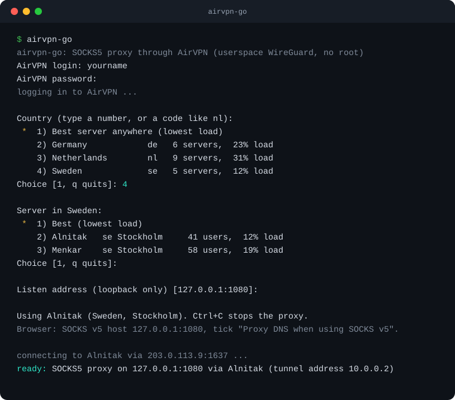

<div align="center">


**Your AirVPN account as a local SOCKS5 port.<br>No root. No TUN device. No system routes.**


</div>

---

`airvpn-go` logs in to your AirVPN account, picks a server, brings up a WireGuard tunnel **inside its own process**, and serves a SOCKS5 proxy on `127.0.0.1`. Point one browser, one script, or one agent at that port and only that traffic leaves through AirVPN. Everything else on your machine keeps its normal route.

Eddie and the AirVPN Suite connect the whole system. `airvpn-go` is for the other case: *this app, and nothing else.*

<div align="center">

<br><sub>The interactive menu (illustrative session).</sub>
</div>

## Quick start

```sh
go install github.com/MQ37/airvpn-go@latest
airvpn-go
```

That is the whole install: one static binary in `$(go env GOPATH)/bin` (Go 1.25 or newer). Run `airvpn-go` with no arguments for the interactive menu.

Then set your browser to **SOCKS v5, `127.0.0.1`, port `1080`**, and tick *Proxy DNS when using SOCKS v5* so hostnames are resolved inside the tunnel. Ctrl+C stops the proxy.

**Prefer a sandbox?** Build and run it in rootless [podman](https://podman.io) instead: nothing is built or run on the host, and the container is read-only with no capabilities.

```sh
git clone https://github.com/MQ37/airvpn-go && cd airvpn-go
./build.sh install      # puts a podman launcher called `airvpn-go` in ~/.local/bin
```

## For humans

Run `airvpn-go` with no arguments. You are asked for your login and password (hidden), then:

1. **Country**: a number, or type a code like `nl`. Enter picks the best server anywhere.
2. **Server**: Enter picks the least loaded one in that country.
3. **Device key**: only asked if your account has several.
4. **Listen address**: Enter keeps `127.0.0.1:1080`.

`q` quits any menu.

## For scripts and agents

Every command works without a terminal. It never prompts when stdin is not a terminal or with `-no-input`. stdout carries data only; logs and errors go to stderr.

```sh
airvpn-go countries -json                      # countries, servers, load
airvpn-go servers -country nl                  # least loaded first
airvpn-go socks -country nl                    # best open server in the Netherlands
airvpn-go socks -s Alnitak -l 127.0.0.1:9050   # a named server, another port
airvpn-go socks -country de -check             # log in, handshake, report, exit
airvpn-go socks -c airvpn.conf                 # a Config Generator file, no login
airvpn-go forget                               # delete saved credentials
```

With `-json`, `socks` prints one line on stdout once the tunnel is up **and** the port is listening, so a caller can start it in the background and wait for it:

```json
{"event":"ready","listen":"127.0.0.1:1080","server":"Alnitak","country":"se","endpoint":"203.0.113.9:1637","tunnel_address":"10.0.0.2"}
```

| | |
|---|---|
| **Exit codes** | `0` ok · `1` failure (with `-json`: `{"error":"..."}` on stderr) · `2` usage |
| **`-check`** | exits `0` the moment the WireGuard handshake completes: a one-shot test of credentials, server and network |
| **Help** | `airvpn-go help`, and `-h` on every command |

## How it works

```
 browser ──SOCKS5──▶ 127.0.0.1:1080 ─┐
                                     ▼
                       ┌─────────────────────────────┐
                       │  airvpn-go                  │ ── WireGuard/UDP ──▶ AirVPN server
                       │  userspace WireGuard stack  │
                       └─────────────────────────────┘
 everything else on your machine ──────────────────────────────────────────▶ your normal route
```

- **Login** speaks the same encrypted account API as Eddie: a fresh AES-256 key per request, wrapped with AirVPN's RSA-4096 public key. `act=user` returns your device keys; `act=manifest` returns the server list.
- **The tunnel** is [wireguard-go](https://git.zx2c4.com/wireguard-go) with its userspace network stack (gVisor netstack). There is no kernel interface, so no root and no routing table changes.
- **DNS** for hostnames is resolved by AirVPN's resolver through the tunnel, never by your machine.
- **Fail closed.** If the tunnel drops, the proxy fails. There is no fallback path and nothing to leak through.

## Credentials

Login: `-login` or `AIRVPN_LOGIN`. Password: `AIRVPN_PASSWORD` or `-password-file`, **never a flag** (it would land in the process list and shell history). On a terminal you are simply asked.

**Saving is opt-in.** After a successful login with typed credentials you are asked `Save? [y/N]`. Enter means no. It asks every time you type credentials that are not already saved, and never when they came from the environment or a file, when there is no terminal, or with `-json`.

Saved credentials are used automatically from then on, by scripts too. They are stored **unencrypted** in `~/.config/airvpn-go/credentials` (JSON, file mode `0600`, directory `0700`; a file other users can read is refused). `airvpn-go forget` deletes it. Your WireGuard keys are never written to disk.

## Security notes

- Listens on **loopback only**; it refuses any other address.
- The proxy has **no authentication**: any local process can use the port.
- **SOCKS5 `CONNECT` only** (TCP). No UDP associate.
- The installed `airvpn-go` is a launcher that runs the binary in a **read-only, capability-less podman container**. What it can see: the binary, the credentials directory, and any config or password file you pass with `-c` / `-password-file`.
- Point clients at a **SOCKS** field, not an HTTP/HTTPS proxy field. An HTTP client gets a plain-text hint and a single log line.
- A single dependency: [`golang.zx2c4.com/wireguard`](https://git.zx2c4.com/wireguard-go), pinned to a commit, plus what it requires.

## Build and test

Everything runs in rootless podman; tests need no network and use RAM-only scratch.

```sh
./build.sh build        # static binary in dist/
./build.sh test         # unit + end-to-end tests
./build.sh install      # binary + podman launcher in ~/.local
```

The end-to-end test runs a fake AirVPN API and a real in-process WireGuard peer, then reaches a TCP service through the SOCKS port.

## Status

Verified against the live service: login, server list and the WireGuard handshake. Not yet covered: accounts with two-factor authentication, and long unattended runs. The proxy does not switch servers by itself.

## Credits and disclaimer

The account API was worked out by reading [Eddie](https://github.com/AirVPN/Eddie) (GPL-3.0); this is an independent reimplementation and no Eddie code is copied. The tunnel is [wireguard-go](https://git.zx2c4.com/wireguard-go).

`airvpn-go` is an independent project. It is **not affiliated with or endorsed by AirVPN**, and it needs your own AirVPN account. AirVPN is a trademark of its owner.
